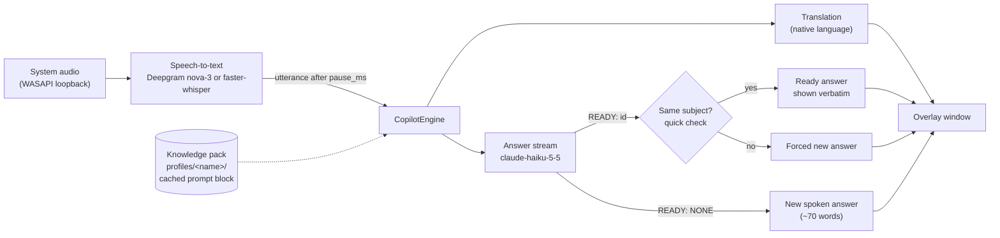

# Interview Copilot

**A real-time copilot for English-language job interviews. It listens to the call, translates each question into your native language and shows a complete, ready-to-speak answer built only from your own resume, projects and notes.**

[](https://www.python.org/downloads/)
[](#requirements)
[](LICENSE)
[](https://github.com/mateusmirandaia/interview-copilot/actions/workflows/ci.yml)

> Leia em português: [README.pt-BR.md](README.pt-BR.md)

---

## What it does

1. **Captures system audio** (Teams, Meet, Zoom, a YouTube video) through WASAPI loopback. It hears the interviewer, not your microphone.
2. **Transcribes in streaming** with Deepgram `nova-3` (cloud, with keyterm prompting) or `faster-whisper` (local).
3. **Detects the end of the question** after a short pause (`pause_ms`, default 700 ms).
4. **Runs two Claude calls in parallel:**
   - a short **translation** of the question into your native language;
   - the **answer**: either one of your **ready answers**, shown verbatim, or a new spoken answer of about 70 words written only from your profile.
5. **Checks ready answers** with a quick "same subject?" call before showing them, and regenerates when the match is wrong.
6. **Shows everything in an always-on-top overlay**: live transcript, question, translation, a one-line *intent* ("what they want to know"), the answer and the measured latency.
7. **On demand** (hotkey), re-answers the last question with **web search restricted to the official documentation domains** of your profile.

Measured in practice: **about 0.5 to 1 s from the end of the question to the first words on screen** for ready answers, plus about 0.7 s of pause detection.

## Architecture



More detail (threads, queues, latency budget, prompt caching): [docs/ARCHITECTURE.md](docs/ARCHITECTURE.md).

## Features

- **Fast by design**: `claude-haiku-5-5` (the fastest Claude model) with thinking disabled and `effort = "low"`, prompt caching of the whole knowledge block (1 h TTL, warmed at startup), translation in parallel.
- **Ready answers, verbatim**: your prepared answers are displayed exactly as you wrote them. The model only picks *which* one, and a second quick check confirms it is the same question.
- **Grounded answers**: facts only from your profile, real stories only from your projects file, one case per answer, no invented numbers. If you have not done something, the answer says so first and pivots to what you know.
- **Speech-recognition aware**: a vocabulary file feeds Deepgram keyterms (up to 100) and spelling fixes; transcript replacements fix recurring mistakes before anything else.
- **Official docs**: download reference pages into the profile (`download-docs`), or press a hotkey to search them live with `claude-sonnet-5-5` and the Anthropic web search tool, restricted to your allowed domains.
- **Generic profiles**: one folder per candidate. A fictional, fully working example (*Alex Morgan, Senior Python Backend Engineer*) ships with the repo.
- **Evals**: run a question set through the real engine, score it with an LLM judge, and compare rounds as you refine your files.
- **Testable without audio**: `simulate`, `check` and the full unit test suite run on Linux CI with an offline mock server.

## The knowledge pack (your profile)

Everything the copilot knows about you lives in one folder under `profiles/`. The active profile is `[profile] path` in the settings (default `profiles/example`) or `--profile PATH` on any command.

The loader reads every `.md`, `.txt` and `.docx` file inside the numbered folders, in path order, and builds one cached context block. Each folder has a clear job:

| Folder / file | What to put there | Example file |
|---|---|---|
| `profile.toml` | Candidate name, target role, native language, ready-answers file, allowed research domains, transcript replacements | `profiles/example/profile.toml` |
| `01-instructions/` | How the copilot must behave **for this candidate and this interview**: interview focus, tone, candidate-specific do's and don'ts | `01-instructions/instructions.md` |
| `02-resume/` | **Your resume**: summary, stack, experience, education. This is where the copilot reads who you are | `02-resume/resume.md` |
| `03-projects/` | **Your real cases** (the only source of stories, used exactly as written) and a `Topic → case` map table | `03-projects/projects.md` |
| `04-skills/` | **Technical knowledge**, one file per skill, language or platform | `04-skills/python.md`, `04-skills/fastapi.md`, `04-skills/sql.md` |
| `05-ready-answers/` | **Prepared answers** (`.md` or `.docx`). Each `##` / `###` heading is one answer, shown verbatim when the question matches | `05-ready-answers/ready-answers.md` |
| `06-job/` | The **target job**: description, company, interviewer notes, questions you want to ask | `06-job/job.md` |
| `07-official-docs/` | `links.txt` (one URL per line) and the pages downloaded from it as `.md`. Outranks the model's general knowledge | `07-official-docs/links.txt` |
| `vocabulary.txt` | Names and terms the transcription must get right (one per line). Sent as STT keyterms and spelling hints | `profiles/example/vocabulary.txt` |
| `evals/questions.json` | Test questions for this profile, with expected terms and forbidden words | `profiles/example/evals/questions.json` |

Start from `profiles/_template/` (empty skeleton) or read `profiles/example/` to see a complete profile. Step-by-step guide and writing rules: [docs/CUSTOMIZING.md](docs/CUSTOMIZING.md).

Your own profile (for example `profiles/me/`) is **gitignored**: only `profiles/README.md`, `_template/` and `example/` are committed.

## Quick start (Windows, PowerShell)

### Requirements

- Windows 10 or 11 (audio loopback uses WASAPI).
- Python 3.11 or newer (3.12 recommended).
- An [Anthropic API key](https://console.anthropic.com/).
- A [Deepgram API key](https://console.deepgram.com/) (recommended; Deepgram offers free starting credit). Without it, the app falls back to local `faster-whisper`.

### Install and run

```powershell
git clone https://github.com/mateusmirandaia/interview-copilot.git
cd interview-copilot
.\scripts\setup.ps1                       # creates .venv and installs the package (add -Whisper for local STT)
.\.venv\Scripts\Activate.ps1

# API keys: either environment variables (then open a NEW terminal)...
setx ANTHROPIC_API_KEY "sk-ant-..."
setx DEEPGRAM_API_KEY "your-deepgram-key"
# ...or a .env file at the repo root (copy .env.example to .env and fill it in)

python -m interview_copilot check         # keys, profile files, ready answers, tokens, 4 sample questions
python -m interview_copilot simulate "Tell me about yourself."
python -m interview_copilot test-audio    # play a video: records 8 s to logs\capture_test.wav with a level meter
python -m interview_copilot run           # the overlay with live audio
```

The default profile is the fictional example, so every command works right after setup. Point to your own profile with `--profile profiles\me` or in `config\settings.local.toml`.

Shortcut: `.\scripts\run.ps1` activates the venv and runs any command (default `run`); `scripts\run.cmd` does the same on double-click.

## Test it with a YouTube mock interview

1. Open YouTube and search for **"mock job interview questions and answers"** (or a technical one, such as "Python backend interview questions").
2. Check the audio: `python -m interview_copilot test-audio` while the video plays. The level meter must move with the video. If it stays flat, run `python -m interview_copilot devices` and set `[audio] device_name`.
3. Try the terminal prototype: `python -m interview_copilot mvp` (capture + transcription + translation), then `mvp --suggest` to add answers.
4. Run the full app: `python -m interview_copilot run` and play the video.

More smoke tests and the end-to-end checklist: [docs/TESTING.md](docs/TESTING.md).

## Hotkeys

| Action | Global (call window in focus) | Overlay in focus |
|---|---|---|
| Suggest now (current transcript, or repeat the last question) | `Ctrl+Alt+S` | `F8` |
| Research the last question in the official docs (web search) | `Ctrl+Alt+D` | `F7` |
| Clear the screen | `Ctrl+Alt+C` | `F9` |
| Pause / resume | `Ctrl+Alt+P` | `F10` |
| Scroll the answer | `Ctrl+Alt+Down` / `Ctrl+Alt+Up` | arrow keys or mouse wheel |

Global hotkeys are configurable in `[hotkeys]` (pynput format).

## Configuration

Three layers, from general to specific:

| File | Committed | Purpose |
|---|---|---|
| `config/settings.toml` | yes | All defaults: models, effort, answer length, STT, audio, UI, hotkeys, evals |
| `config/settings.local.toml` | no (gitignored) | Your overrides, deep-merged on top of the defaults. Only write the keys you change |
| `profiles/<name>/profile.toml` | per profile | Candidate data, ready-answers file, research domains, transcript replacements |

Example `config/settings.local.toml`:

```toml
[profile]
path = "profiles/me"

[stt]
pause_ms = 800        # wait a bit longer before deciding the question ended
```

Secrets come only from the environment (`ANTHROPIC_API_KEY`, `DEEPGRAM_API_KEY`) or a `.env` file at the repo root; real environment variables win. Every command also accepts `--settings PATH` and `--profile PATH`.

## Evals

`python -m interview_copilot eval` runs every question in `profiles/<name>/evals/questions.json` through the real engine and writes a report:

- timings (first token, first content, total) and required / forbidden terms;
- an LLM judge (`claude-sonnet-5-5`) scoring six criteria from 0 to 2: correctness, real cases, simplicity, focus, speakable, answers the question;
- automatic checks: more than one real case in an answer, answers over `answer_words_max`;
- worst 10 answers, recurring problems, improvement suggestions, transcription-variant table;
- comparison with a previous round (`--round v2 --compare-with results_v1.json`).

Reports go to `logs/evals/`. The workflow (run, read, adjust files, rerun) is in [docs/CUSTOMIZING.md](docs/CUSTOMIZING.md#refine-iteratively-with-evals).

## Project structure

```
interview-copilot/
├── config/settings.toml          # committed defaults (settings.local.toml overrides, gitignored)
├── profiles/
│   ├── README.md                 # what each profile folder is for
│   ├── _template/                # empty skeleton to copy
│   └── example/                  # fictional, fully working profile (Alex Morgan)
├── src/interview_copilot/
│   ├── cli.py  settings.py  app.py  console.py  render.py
│   ├── audio/      capture.py                    # WASAPI loopback, resampling to 16 kHz mono
│   ├── stt/        base.py  deepgram.py  whisper.py
│   ├── knowledge/  loader.py  ready_answers.py  vocabulary.py  docs_downloader.py
│   ├── ai/         prompts.py  engine.py  parsing.py
│   ├── ui/         overlay.py                    # tkinter always-on-top window
│   └── evals/      runner.py  report.py  judge.py
├── scripts/      setup.ps1  run.ps1  run.cmd
├── tests/        # pytest, offline, mock HTTP server
├── docs/         ARCHITECTURE.md  CUSTOMIZING.md  TESTING.md  TROUBLESHOOTING.md
├── logs/         # runtime logs, answer-selection log, eval reports (gitignored)
└── .github/workflows/ci.yml      # ruff + pytest on Ubuntu, Python 3.11 / 3.12
```

## Responsible use

- **Check the rules of each interview.** Many hiring processes do not allow assistance tools during interviews or assessments. Respect them, and disclose the tool when that is expected.
- **Recording consent.** The app transcribes the other side of a call. Follow the laws and policies on recording and transcription where you and the interviewer are.
- **Designed for practice and accessibility**: rehearsing with mock interviews, refining your answers with evals, and supporting non-native speakers who need a translation to follow the conversation.
- **Never invent experience.** The copilot is built to use only what is in your profile, and to say "I haven't done that" when it is not there. Keep your files honest; the tool cannot make up for a profile that is not true.

## Roadmap

- Audio capture on macOS and Linux.
- Interview languages other than English (`[stt] language`), with translation in both directions.
- More STT providers behind the `Transcriber` interface.
- Packaged Windows executable.
- Eval history viewer (charts across rounds).

## Documentation

- [Architecture](docs/ARCHITECTURE.md)
- [Customizing your profile](docs/CUSTOMIZING.md)
- [Testing](docs/TESTING.md)
- [Troubleshooting](docs/TROUBLESHOOTING.md)
- [Changelog](CHANGELOG.md)

## License

[MIT](LICENSE) © 2026 Mateus Maia Miranda

---

Built by **Mateus Maia Miranda**.
