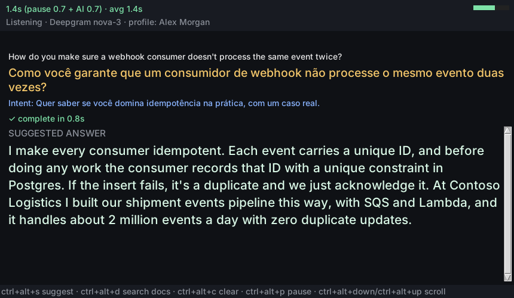
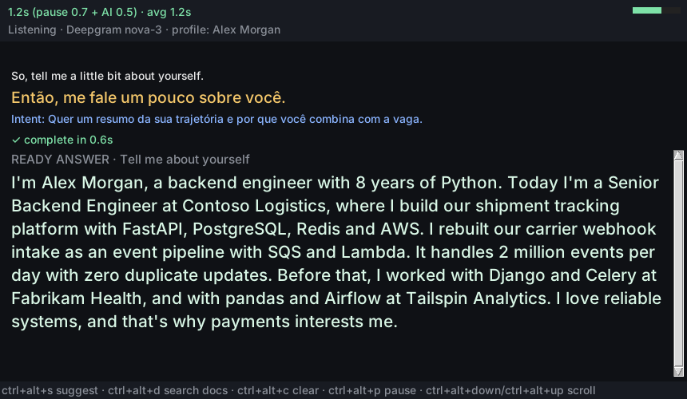
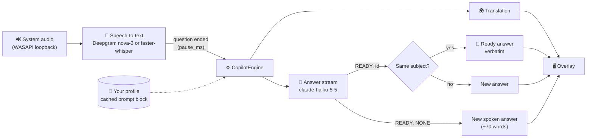

<div align="center">

# 🎧 Interview Copilot

**Your real-time copilot for English-language job interviews.**

It listens to the call, translates each question into your language and shows a complete,
ready-to-speak answer, built **only** from your own resume, projects and notes.

[](https://github.com/mateusmirandaia/interview-copilot/actions/workflows/ci.yml)
[](https://www.python.org/downloads/)
[](#-requirements)
[](https://docs.claude.com/)
[](https://developers.deepgram.com/)
[](LICENSE)

[Quick start](#-quick-start-5-minutes) ·
[How it works](#-how-it-works) ·
[Your profile](#-your-profile-the-knowledge-pack) ·
[Evals](#-evals-measure-and-refine) ·
[Docs](#-documentation) ·
[🇧🇷 Português](README.pt-BR.md)

<br/>



<sub>The real overlay, rendered with the fictional example profile that ships with the repo.</sub>

</div>

---

## ✨ Highlights

| | |
|---|---|
| ⚡ **About 1 second** | From the end of the question to the first words on screen, using `claude-haiku-5-5`, prompt caching and parallel calls |
| 🌍 **Live translation** | Each question is translated into your native language, with a one-line *intent* that tells you what they really want to know |
| 📝 **Your answers, verbatim** | Prepared answers are shown exactly as you wrote them. The model only picks *which* one, and a second check confirms it is the same question |
| 🧠 **Grounded, never invented** | Facts only from your profile, stories only from your real projects, no made-up numbers. If you haven't done something, it says so |
| 📚 **Official docs on demand** | One hotkey re-answers using web search restricted to the official documentation sites you allow |
| 🧪 **Evals built in** | Run a question set through the real engine, score it with an LLM judge and compare rounds as you refine your files |
| 🧩 **Any candidate, any role** | One folder per profile. Swap the folder, and the copilot becomes someone else's |

<div align="center">

<br/><sub>A prepared answer recognized from a differently worded question and shown verbatim.</sub>
</div>

---

## 🚀 Quick start (5 minutes)

### ✅ Requirements

- **Windows 10 or 11** (system audio is captured with WASAPI loopback)
- **Python 3.11+** (3.12 recommended), from [python.org](https://www.python.org/downloads/), with *Add python.exe to PATH* checked
- An **Anthropic API key**: [console.anthropic.com](https://console.anthropic.com/)
- A **Deepgram API key** (recommended, free starting credit): [console.deepgram.com](https://console.deepgram.com/). Without it, the app falls back to local `faster-whisper`

### 1. Install

```powershell
git clone https://github.com/mateusmirandaia/interview-copilot.git
cd interview-copilot
.\scripts\setup.ps1              # creates .venv and installs everything (add -Whisper for local STT)
.\.venv\Scripts\Activate.ps1
```

### 2. Add your API keys

```powershell
copy .env.example .env           # then open .env and paste your keys
```

<details>
<summary>Prefer environment variables?</summary>

```powershell
setx ANTHROPIC_API_KEY "sk-ant-..."
setx DEEPGRAM_API_KEY "your-deepgram-key"
# open a NEW terminal afterwards: setx only applies to new windows
```

Real environment variables win over `.env`. Keys are never read from code or committed files.
</details>

### 3. Check and try it

```powershell
python -m interview_copilot check                              # keys, profile, ready answers, sample questions
python -m interview_copilot simulate "Tell me about yourself." # one answer in the terminal, no audio
python -m interview_copilot test-audio                         # play any video: the level meter must move
python -m interview_copilot run                                # 🎉 the overlay with live audio
```

Every command works right after setup, because the default profile is the fictional example (*Alex Morgan, Senior Python Backend Engineer*). Next step: [make it yours](#-make-it-yours).

> 💡 **Shortcut:** `.\scripts\run.ps1` activates the venv and runs any command (default `run`). `scripts\run.cmd` does the same with a double-click.

### 🎬 Rehearse with a YouTube mock interview

1. Search YouTube for **"mock job interview questions and answers"** (or "Python backend interview questions").
2. Run `python -m interview_copilot run` and play the video.
3. Watch questions, translations and answers appear. No audio? Run `python -m interview_copilot devices` and set `[audio] device_name`.

---

## 🧭 How it works



1. **Captures the computer's sound** (Teams, Meet, Zoom, a video). It hears the interviewer, not your microphone.
2. **Transcribes in streaming** and detects the end of the question after a short pause (default 700 ms).
3. **Runs two Claude calls in parallel**: a short translation, and the answer (a ready answer, or a new ~70-word spoken answer from your profile).
4. **Double-checks ready answers** with a quick "same subject?" call, and regenerates when the match is wrong.
5. **Shows everything** in an always-on-top window: live transcript, question, translation, intent, answer and measured latency.

Threads, queues, latency budget and prompt caching: [docs/ARCHITECTURE.md](docs/ARCHITECTURE.md).

---

## 📁 Your profile (the knowledge pack)

Everything the copilot knows about you lives in **one folder** under `profiles/`. It reads every `.md`, `.txt` and `.docx` inside the numbered folders and builds one cached context block.

```
profiles/me/
├── profile.toml          ⚙️  name, target role, native language, research domains, transcript fixes
├── 01-instructions/      🎯  how to behave for this candidate and this interview
├── 02-resume/            👤  your resume: who you are
├── 03-projects/          🏆  your real cases, the only source of stories
├── 04-skills/            🛠️  technical knowledge, one file per skill or language
├── 05-ready-answers/     📝  prepared answers, shown verbatim when the question matches
├── 06-job/               💼  the target job, company and interviewer notes
├── 07-official-docs/     📚  links.txt + downloaded official pages (outrank general knowledge)
├── vocabulary.txt        🔤  names and terms the transcription must get right
└── evals/questions.json  🧪  test questions with expected and forbidden terms
```

| Folder / file | What to put there |
|---|---|
| `01-instructions/` | Interview focus, tone, candidate-specific do's and don'ts |
| `02-resume/` | Summary, stack, experience, education |
| `03-projects/` | One `## Case` per real story (situation, action, numbers), with a `- **Keywords:**` line, plus a *Topic → case* map |
| `04-skills/` | `python.md`, `sql.md`, `fastapi.md`... what you know and how you'd explain it |
| `05-ready-answers/` | One `##` heading per question, the answer below it (`.md` or `.docx`) |
| `06-job/` | Job description, company facts, questions you want to ask |
| `07-official-docs/` | One URL per line in `links.txt`, then run `download-docs` |

### 🪄 Make it yours

```powershell
Copy-Item -Recurse profiles\_template profiles\me    # gitignored: your data never goes to GitHub
# fill in the folders, then:
python -m interview_copilot check --profile profiles\me
python -m interview_copilot run   --profile profiles\me
```

To make it the default, create `config\settings.local.toml` (also gitignored):

```toml
[profile]
path = "profiles/me"
```

Writing rules and the full step-by-step guide: [docs/CUSTOMIZING.md](docs/CUSTOMIZING.md). Want to see a finished profile first? Open [`profiles/example/`](profiles/example/).

---

## ⌨️ Hotkeys

| Action | Global (call in focus) | Overlay in focus |
|---|---|---|
| Suggest now / repeat the last question | `Ctrl+Alt+S` | `F8` |
| Research the last question in the official docs | `Ctrl+Alt+D` | `F7` |
| Clear the screen | `Ctrl+Alt+C` | `F9` |
| Pause / resume | `Ctrl+Alt+P` | `F10` |
| Scroll the answer | `Ctrl+Alt+↓` / `Ctrl+Alt+↑` | arrows or mouse wheel |

All global hotkeys are configurable in `[hotkeys]`.

---

## 🧪 Evals: measure and refine

```powershell
python -m interview_copilot eval --round v1                       # run + judge + report
# edit your files...
python -m interview_copilot eval --round v2 --compare-with results_v1.json   # see what improved
```

Each round writes `logs/evals/report_<round>.md` with:

- ⏱️ timings (first token, first content, total) and expected / forbidden terms
- ⚖️ an LLM judge (`claude-sonnet-5-5`) scoring **correctness, real cases, simplicity, focus, speakable, answers the question** (0–2 each)
- 🔎 automatic checks: more than one case per answer, answers over the word limit
- 📉 the worst 10 answers, recurring problems and concrete suggestions

The loop is simple: **run → read the report → fix your files → run again.** Details: [docs/TESTING.md](docs/TESTING.md).

---

## ⚙️ Configuration

| File | Committed | Purpose |
|---|---|---|
| `config/settings.toml` | ✅ | All defaults: models, answer length, STT, audio, UI, hotkeys, evals |
| `config/settings.local.toml` | ❌ gitignored | Your overrides, merged on top. Only write what you change |
| `profiles/<name>/profile.toml` | per profile | Candidate data, ready-answers file, research domains, transcript fixes |
| `.env` | ❌ gitignored | `ANTHROPIC_API_KEY`, `DEEPGRAM_API_KEY` |

<details>
<summary>All commands</summary>

| Command | What it does |
|---|---|
| `run` | The overlay with live audio |
| `simulate "question"` | One answer in the terminal, no audio |
| `check` | Validates keys, profile, ready answers and token size |
| `devices` | Lists audio devices |
| `test-audio` | Records 8 s of system audio with a level meter |
| `mvp [--suggest]` | Terminal prototype: capture + transcription + translation (+ answers) |
| `download-docs` | Downloads the pages in `07-official-docs/links.txt` |
| `eval` | Runs the eval set (`--round`, `--compare-with`, `--ids`, `--no-judge`, `--rejudge`, `--parallel`) |

Global options: `--profile PATH`, `--settings PATH`.
</details>

<details>
<summary>Project structure</summary>

```
interview-copilot/
├── config/settings.toml          # committed defaults
├── profiles/
│   ├── _template/                # empty skeleton to copy
│   └── example/                  # fictional, fully working profile
├── src/interview_copilot/
│   ├── audio/      capture.py    # WASAPI loopback, 16 kHz mono
│   ├── stt/        deepgram.py  whisper.py
│   ├── knowledge/  loader.py  ready_answers.py  vocabulary.py  docs_downloader.py
│   ├── ai/         prompts.py  engine.py  parsing.py
│   ├── ui/         overlay.py    # tkinter always-on-top window
│   └── evals/      runner.py  judge.py  report.py
├── scripts/        setup.ps1  run.ps1  run.cmd
├── tests/          # pytest, offline, with a mock API server
└── docs/           ARCHITECTURE  CUSTOMIZING  TESTING  TROUBLESHOOTING
```
</details>

<details>
<summary>Development</summary>

```powershell
pip install -e ".[dev]"
ruff check src tests
pytest -q            # ~100 tests, offline, about 10 s
```

CI runs ruff and pytest on Ubuntu with Python 3.11 and 3.12 for every push.
</details>

---

## 🤝 Responsible use

- **Check the rules of each interview.** Many hiring processes do not allow assistance tools. Respect them, and disclose the tool when that is expected.
- **Recording consent.** The app transcribes the other side of a call. Follow the recording and transcription laws where you and the interviewer are.
- **Made for practice and accessibility:** rehearsing with mock interviews, refining answers with evals, and helping non-native speakers follow the conversation.
- **Never invent experience.** The copilot only uses what is in your profile. Keep your files honest.

---

## 🗺️ Roadmap

- [ ] Audio capture on macOS and Linux
- [ ] Interview languages beyond English, with two-way translation
- [ ] More STT providers behind the `Transcriber` interface
- [ ] Packaged Windows executable
- [ ] Eval history viewer with charts across rounds

## 📖 Documentation

[Architecture](docs/ARCHITECTURE.md) · [Customizing](docs/CUSTOMIZING.md) · [Testing](docs/TESTING.md) · [Troubleshooting](docs/TROUBLESHOOTING.md) · [Changelog](CHANGELOG.md)

---

<div align="center">

Built by **Mateus Maia Miranda** · [MIT License](LICENSE)

If this project helped you, consider giving it a ⭐

</div>
