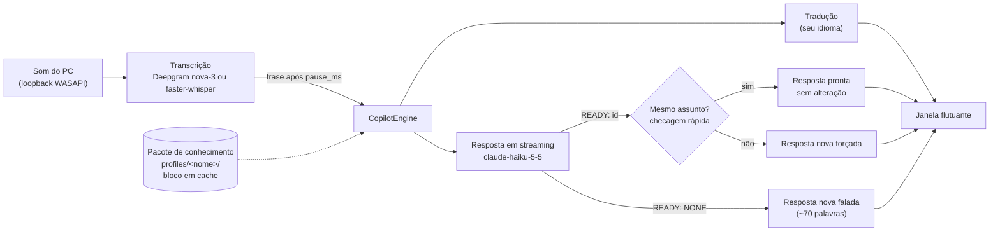

# Interview Copilot

**Um copiloto em tempo real para entrevistas de emprego em inglês. Ele ouve a call, traduz cada pergunta para o seu idioma e mostra uma resposta completa, pronta para falar, montada só com o seu currículo, os seus projetos e as suas anotações.**

[](https://www.python.org/downloads/)
[](#requisitos)
[](LICENSE)
[](https://github.com/mateusmirandaia/interview-copilot/actions/workflows/ci.yml)

> Read in English: [README.md](README.md)

---

## O que ele faz

1. **Captura o som do computador** (Teams, Meet, Zoom, um vídeo do YouTube) por loopback WASAPI. Ele ouve o entrevistador, não o seu microfone.
2. **Transcreve em streaming** com o Deepgram `nova-3` (nuvem, com keyterm prompting) ou com o `faster-whisper` (local).
3. **Detecta o fim da pergunta** depois de uma pausa curta (`pause_ms`, padrão 700 ms).
4. **Faz duas chamadas ao Claude em paralelo:**
   - uma **tradução** curta da pergunta para o seu idioma;
   - a **resposta**: uma das suas **respostas prontas**, mostrada sem nenhuma alteração, ou uma resposta nova, falada, de cerca de 70 palavras, escrita só com o seu perfil.
5. **Confere a resposta pronta** com uma checagem rápida ("é o mesmo assunto?") antes de mostrá-la. Se não for, gera uma resposta nova.
6. **Mostra tudo numa janela sempre por cima**: transcrição ao vivo, pergunta, tradução, a *intenção* em uma linha ("o que ele quer saber"), a resposta e a latência medida.
7. **Sob demanda** (atalho), refaz a resposta da última pergunta com **pesquisa na web restrita aos domínios de documentação oficial** do seu perfil.

Medido na prática: **cerca de 0,5 a 1 s entre o fim da pergunta e as primeiras palavras na tela** para respostas prontas, mais cerca de 0,7 s de detecção da pausa.

## Arquitetura



Mais detalhes (threads, filas, orçamento de latência, prompt caching): [docs/ARCHITECTURE.md](docs/ARCHITECTURE.md) (em inglês).

## Recursos

- **Rápido por projeto**: `claude-haiku-5-5` (o modelo Claude mais rápido) com thinking desligado e `effort = "low"`, prompt caching de todo o bloco de conhecimento (TTL de 1 h, aquecido ao abrir o app) e tradução em paralelo.
- **Respostas prontas, palavra por palavra**: as suas respostas preparadas aparecem exatamente como você escreveu. O modelo só escolhe *qual* usar, e uma segunda checagem confirma que é a mesma pergunta.
- **Respostas com base real**: fatos só do seu perfil, histórias só do arquivo de projetos, um caso por resposta, nenhum número inventado. Se você não fez algo, a resposta diz isso primeiro e muda para o que você sabe.
- **Preparado para erros de transcrição**: um arquivo de vocabulário vira keyterms do Deepgram (até 100) e dicas de grafia. As substituições de transcrição corrigem erros recorrentes antes de tudo.
- **Documentação oficial**: baixe páginas de referência para o perfil (`download-docs`) ou aperte um atalho para pesquisar ao vivo com o `claude-sonnet-5-5` e a ferramenta de web search da Anthropic, restrita aos domínios permitidos.
- **Perfis genéricos**: uma pasta por candidato. O repositório traz um exemplo fictício e completo (*Alex Morgan, Senior Python Backend Engineer*).
- **Evals**: rode um conjunto de perguntas no motor real, avalie com um juiz (LLM) e compare rodadas enquanto ajusta os arquivos.
- **Testável sem áudio**: `simulate`, `check` e todos os testes unitários rodam no CI em Linux, com um servidor falso offline.

## O pacote de conhecimento (seu perfil)

Tudo o que o copiloto sabe sobre você fica numa pasta dentro de `profiles/`. O perfil ativo é o `[profile] path` das configurações (padrão `profiles/example`) ou o `--profile CAMINHO` em qualquer comando.

O app lê todos os arquivos `.md`, `.txt` e `.docx` das pastas numeradas, em ordem de caminho, e monta um único bloco de contexto em cache. Cada pasta tem uma função:

| Pasta / arquivo | O que colocar | Arquivo de exemplo |
|---|---|---|
| `profile.toml` | Nome do candidato, vaga, idioma nativo, arquivo de respostas prontas, domínios de pesquisa, substituições de transcrição | `profiles/example/profile.toml` |
| `01-instructions/` | Como o copiloto deve agir **para este candidato e esta entrevista**: foco, tom, o que fazer e o que evitar | `01-instructions/instructions.md` |
| `02-resume/` | **Seu currículo**: resumo, stack, experiência, formação. É aqui que o copiloto lê quem você é | `02-resume/resume.md` |
| `03-projects/` | **Seus casos reais** (a única fonte de histórias, usadas exatamente como estão) e uma tabela `Topic → case` | `03-projects/projects.md` |
| `04-skills/` | **Conhecimento técnico**, um arquivo por skill, linguagem ou plataforma | `04-skills/python.md`, `04-skills/fastapi.md`, `04-skills/sql.md` |
| `05-ready-answers/` | **Respostas preparadas** (`.md` ou `.docx`). Cada título `##` / `###` é uma resposta, mostrada sem alteração quando a pergunta bate | `05-ready-answers/ready-answers.md` |
| `06-job/` | A **vaga**: descrição, empresa, notas sobre o entrevistador, perguntas que você quer fazer | `06-job/job.md` |
| `07-official-docs/` | `links.txt` (uma URL por linha) e as páginas baixadas a partir dele, em `.md`. Vale mais que o conhecimento geral do modelo | `07-official-docs/links.txt` |
| `vocabulary.txt` | Nomes e termos que a transcrição precisa acertar (um por linha). Vão como keyterms e dicas de grafia | `profiles/example/vocabulary.txt` |
| `evals/questions.json` | Perguntas de teste do perfil, com termos esperados e palavras proibidas | `profiles/example/evals/questions.json` |

Comece pelo `profiles/_template/` (esqueleto vazio) ou leia o `profiles/example/` para ver um perfil completo. Passo a passo e regras de escrita: [docs/CUSTOMIZING.md](docs/CUSTOMIZING.md).

O seu perfil (por exemplo `profiles/me/`) fica **fora do git**: só `profiles/README.md`, `_template/` e `example/` vão para o repositório.

## Início rápido (Windows, PowerShell)

### Requisitos

- Windows 10 ou 11 (o loopback de áudio usa WASAPI).
- Python 3.11 ou mais recente (recomendo o 3.12).
- Uma [chave da API da Anthropic](https://console.anthropic.com/).
- Uma [chave do Deepgram](https://console.deepgram.com/) (recomendado; o Deepgram dá crédito grátis para começar). Sem ela, o app usa o `faster-whisper` local.

### Instalar e rodar

```powershell
git clone https://github.com/mateusmirandaia/interview-copilot.git
cd interview-copilot
.\scripts\setup.ps1                       # cria a .venv e instala o pacote (use -Whisper para STT local)
.\.venv\Scripts\Activate.ps1

# Chaves: variáveis de ambiente (depois abra um terminal NOVO)...
setx ANTHROPIC_API_KEY "sk-ant-..."
setx DEEPGRAM_API_KEY "sua-chave-deepgram"
# ...ou um arquivo .env na raiz (copie o .env.example para .env e preencha)

python -m interview_copilot check         # chaves, arquivos do perfil, respostas prontas, tokens, 4 perguntas de teste
python -m interview_copilot simulate "Tell me about yourself."
python -m interview_copilot test-audio    # com um vídeo tocando: grava 8 s em logs\capture_test.wav
python -m interview_copilot run           # a janela com áudio ao vivo
```

O perfil padrão é o exemplo fictício, então todos os comandos funcionam logo depois da instalação. Para usar o seu perfil, passe `--profile profiles\me` ou defina no `config\settings.local.toml`.

Atalho: `.\scripts\run.ps1` ativa a venv e roda qualquer comando (padrão `run`). O `scripts\run.cmd` faz o mesmo com dois cliques.

## Teste com uma entrevista simulada do YouTube

1. Abra o YouTube e busque **"mock job interview questions and answers"** (ou uma técnica, como "Python backend interview questions").
2. Confira o áudio: rode `python -m interview_copilot test-audio` com o vídeo tocando. A barra de nível deve se mexer com o vídeo. Se ficar parada, rode `python -m interview_copilot devices` e defina `[audio] device_name`.
3. Teste o protótipo no terminal: `python -m interview_copilot mvp` (captura + transcrição + tradução) e depois `mvp --suggest` para incluir as respostas.
4. Rode o app completo: `python -m interview_copilot run` e dê play no vídeo.

Mais testes rápidos e o roteiro de ponta a ponta: [docs/TESTING.md](docs/TESTING.md).

## Atalhos

| Ação | Global (com a call em foco) | Com a janela em foco |
|---|---|---|
| Gerar sugestão agora (transcrição atual ou repete a última pergunta) | `Ctrl+Alt+S` | `F8` |
| Pesquisar a última pergunta na documentação oficial (web search) | `Ctrl+Alt+D` | `F7` |
| Limpar a tela | `Ctrl+Alt+C` | `F9` |
| Pausar / retomar | `Ctrl+Alt+P` | `F10` |
| Rolar a resposta | `Ctrl+Alt+↓` / `Ctrl+Alt+↑` | setas ou roda do mouse |

Os atalhos globais ficam em `[hotkeys]` (formato do pynput).

## Configuração

Três camadas, da mais geral para a mais específica:

| Arquivo | No git | Para que serve |
|---|---|---|
| `config/settings.toml` | sim | Todos os padrões: modelos, effort, tamanho da resposta, STT, áudio, janela, atalhos, evals |
| `config/settings.local.toml` | não | Suas mudanças, mescladas por cima dos padrões. Escreva só as chaves que mudar |
| `profiles/<nome>/profile.toml` | por perfil | Dados do candidato, arquivo de respostas prontas, domínios de pesquisa, substituições de transcrição |

Exemplo de `config/settings.local.toml`:

```toml
[profile]
path = "profiles/me"

[stt]
pause_ms = 800        # espera um pouco mais antes de decidir que a pergunta acabou
```

As chaves vêm só do ambiente (`ANTHROPIC_API_KEY`, `DEEPGRAM_API_KEY`) ou de um arquivo `.env` na raiz. As variáveis de ambiente reais têm prioridade. Todo comando aceita `--settings CAMINHO` e `--profile CAMINHO`.

## Evals

O `python -m interview_copilot eval` passa cada pergunta do `profiles/<nome>/evals/questions.json` pelo motor real e gera um relatório com:

- tempos (primeiro token, primeiro conteúdo, total) e termos obrigatórios / proibidos;
- um juiz (`claude-sonnet-5-5`) que dá nota de 0 a 2 em seis critérios: correção, casos reais, simplicidade, foco, fácil de falar, responde à pergunta;
- checagens automáticas: mais de um caso real na mesma resposta, respostas acima de `answer_words_max`;
- as 10 piores respostas, problemas que se repetem, sugestões de ajuste e a tabela de variantes de transcrição;
- comparação com uma rodada anterior (`--round v2 --compare-with results_v1.json`).

Os relatórios ficam em `logs/evals/`. O ciclo (rodar, ler, ajustar os arquivos, rodar de novo) está em [docs/CUSTOMIZING.md](docs/CUSTOMIZING.md#refine-iteratively-with-evals).

## Estrutura do projeto

```
interview-copilot/
├── config/settings.toml          # padrões (o settings.local.toml sobrescreve e fica fora do git)
├── profiles/
│   ├── README.md                 # para que serve cada pasta do perfil
│   ├── _template/                # esqueleto vazio para copiar
│   └── example/                  # perfil fictício e completo (Alex Morgan)
├── src/interview_copilot/
│   ├── cli.py  settings.py  app.py  console.py  render.py
│   ├── audio/      capture.py                    # loopback WASAPI, reamostragem para 16 kHz mono
│   ├── stt/        base.py  deepgram.py  whisper.py
│   ├── knowledge/  loader.py  ready_answers.py  vocabulary.py  docs_downloader.py
│   ├── ai/         prompts.py  engine.py  parsing.py
│   ├── ui/         overlay.py                    # janela tkinter sempre por cima
│   └── evals/      runner.py  report.py  judge.py
├── scripts/      setup.ps1  run.ps1  run.cmd
├── tests/        # pytest, offline, servidor HTTP falso
├── docs/         ARCHITECTURE.md  CUSTOMIZING.md  TESTING.md  TROUBLESHOOTING.md
├── logs/         # logs, registro da escolha de respostas, relatórios de evals (fora do git)
└── .github/workflows/ci.yml      # ruff + pytest no Ubuntu, Python 3.11 / 3.12
```

## Uso responsável

- **Confira as regras de cada entrevista.** Muitos processos seletivos não permitem ferramentas de apoio durante entrevistas ou avaliações. Respeite essas regras e avise sobre a ferramenta quando isso for esperado.
- **Consentimento de gravação.** O app transcreve o outro lado da call. Siga as leis e as políticas de gravação e transcrição do seu local e do local do entrevistador.
- **Feito para treino e acessibilidade**: ensaiar com entrevistas simuladas, melhorar as suas respostas com evals e ajudar quem não é nativo e precisa de tradução para acompanhar a conversa.
- **Nunca invente experiência.** O copiloto foi feito para usar só o que está no seu perfil e para dizer "não fiz isso" quando não estiver lá. Mantenha os seus arquivos honestos: a ferramenta não corrige um perfil que não é verdadeiro.

## Próximos passos

- Captura de áudio no macOS e no Linux.
- Entrevistas em outros idiomas além do inglês (`[stt] language`), com tradução nos dois sentidos.
- Mais serviços de transcrição pela interface `Transcriber`.
- Executável empacotado para Windows.
- Visualizador do histórico de evals (gráficos entre rodadas).

## Documentação (em inglês)

- [Arquitetura](docs/ARCHITECTURE.md)
- [Como personalizar o seu perfil](docs/CUSTOMIZING.md)
- [Testes](docs/TESTING.md)
- [Solução de problemas](docs/TROUBLESHOOTING.md)
- [Changelog](CHANGELOG.md)

## Licença

[MIT](LICENSE) © 2026 Mateus Maia Miranda

---

Feito por **Mateus Maia Miranda**.
