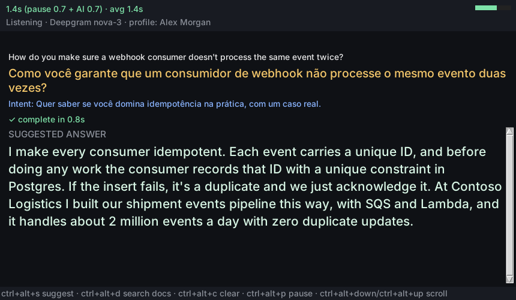
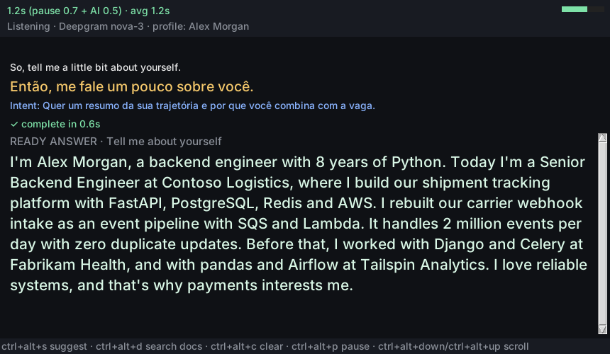
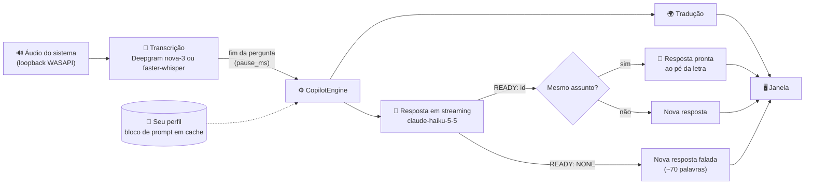

<div align="center">

# 🎧 Interview Copilot

**Seu copiloto em tempo real para entrevistas de emprego em inglês.**

Ele ouve a call, traduz cada pergunta para o seu idioma e mostra uma resposta completa,
pronta para falar, montada **só** com o seu currículo, os seus projetos e as suas anotações.

[](https://github.com/mateusmirandaia/interview-copilot/actions/workflows/ci.yml)
[](https://www.python.org/downloads/)
[](#-requisitos)
[](https://docs.claude.com/)
[](https://developers.deepgram.com/)
[](LICENSE)

[Início rápido](#-início-rápido-5-minutos) ·
[Como funciona](#-como-funciona) ·
[Seu perfil](#-seu-perfil-o-pacote-de-conhecimento) ·
[Evals](#-evals-medir-e-refinar) ·
[Docs](#-documentação) ·
[🇺🇸 English](README.md)

<br/>



<sub>A janela real, com o perfil fictício de exemplo que vem no repositório.</sub>

</div>

---

## ✨ Destaques

| | |
|---|---|
| ⚡ **Cerca de 1 segundo** | Do fim da pergunta até as primeiras palavras na tela, com `claude-haiku-5-5`, prompt caching e chamadas em paralelo |
| 🌍 **Tradução ao vivo** | Cada pergunta é traduzida para o seu idioma, com uma linha de *intenção* que diz o que o entrevistador quer saber de verdade |
| 📝 **Suas respostas, ao pé da letra** | As respostas preparadas aparecem exatamente como você escreveu. O modelo só escolhe *qual*, e uma segunda checagem confirma que é a mesma pergunta |
| 🧠 **Baseado em fatos, nunca inventado** | Fatos só do seu perfil, histórias só dos seus projetos reais, nenhum número inventado. Se você nunca fez algo, ele diz isso |
| 📚 **Documentação oficial na hora** | Um atalho refaz a resposta com busca na web restrita aos sites de documentação oficial que você liberar |
| 🧪 **Evals embutidos** | Rode uma bateria de perguntas no motor real, avalie com um juiz de IA e compare rodadas enquanto refina seus arquivos |
| 🧩 **Qualquer candidato, qualquer vaga** | Uma pasta por perfil. Troque a pasta e o copiloto vira outra pessoa |

<div align="center">

<br/><sub>Uma resposta preparada reconhecida a partir de uma pergunta com outras palavras e exibida ao pé da letra.</sub>
</div>

---

## 🚀 Início rápido (5 minutos)

### ✅ Requisitos

- **Windows 10 ou 11** (o áudio do sistema é capturado por loopback WASAPI)
- **Python 3.11+** (3.12 recomendado), do [python.org](https://www.python.org/downloads/), marcando *Add python.exe to PATH*
- Uma **chave da API da Anthropic**: [console.anthropic.com](https://console.anthropic.com/)
- Uma **chave da Deepgram** (recomendado, tem crédito grátis inicial): [console.deepgram.com](https://console.deepgram.com/). Sem ela, o app usa o `faster-whisper` local

### 1. Instale

```powershell
git clone https://github.com/mateusmirandaia/interview-copilot.git
cd interview-copilot
.\scripts\setup.ps1              # cria o .venv e instala tudo (use -Whisper para transcrição local)
.\.venv\Scripts\Activate.ps1
```

### 2. Coloque as chaves

```powershell
copy .env.example .env           # depois abra o .env e cole as suas chaves
```

<details>
<summary>Prefere variáveis de ambiente?</summary>

```powershell
setx ANTHROPIC_API_KEY "sk-ant-..."
setx DEEPGRAM_API_KEY "sua-chave-deepgram"
# depois abra um terminal NOVO: o setx só vale para janelas novas
```

Variáveis de ambiente reais têm prioridade sobre o `.env`. As chaves nunca ficam no código nem em arquivos versionados.
</details>

### 3. Confira e teste

```powershell
python -m interview_copilot check                              # chaves, perfil, respostas prontas, perguntas de amostra
python -m interview_copilot simulate "Tell me about yourself." # uma resposta no terminal, sem áudio
python -m interview_copilot test-audio                         # toque um vídeo: o medidor de nível precisa se mexer
python -m interview_copilot run                                # 🎉 a janela com áudio ao vivo
```

Todos os comandos funcionam logo depois da instalação, porque o perfil padrão é o exemplo fictício (*Alex Morgan, Senior Python Backend Engineer*). Próximo passo: [deixar com a sua cara](#-deixe-com-a-sua-cara).

> 💡 **Atalho:** `.\scripts\run.ps1` ativa o venv e roda qualquer comando (padrão `run`). O `scripts\run.cmd` faz o mesmo com dois cliques.

### 🎬 Treine com uma entrevista simulada do YouTube

1. Procure no YouTube por **"mock job interview questions and answers"** (ou "Python backend interview questions").
2. Rode `python -m interview_copilot run` e dê play no vídeo.
3. Veja as perguntas, traduções e respostas aparecendo. Sem áudio? Rode `python -m interview_copilot devices` e ajuste `[audio] device_name`.

---

## 🧭 Como funciona



1. **Captura o som do computador** (Teams, Meet, Zoom, um vídeo). Ele ouve o entrevistador, não o seu microfone.
2. **Transcreve em streaming** e detecta o fim da pergunta depois de uma pausa curta (padrão 700 ms).
3. **Faz duas chamadas ao Claude em paralelo**: uma tradução curta e a resposta (uma resposta pronta, ou uma nova resposta falada de ~70 palavras a partir do seu perfil).
4. **Confere as respostas prontas** com uma chamada rápida de "mesmo assunto?" e gera outra quando a escolha estiver errada.
5. **Mostra tudo** numa janela sempre por cima: transcrição ao vivo, pergunta, tradução, intenção, resposta e latência medida.

Threads, filas, orçamento de latência e prompt caching: [docs/ARCHITECTURE.md](docs/ARCHITECTURE.md).

---

## 📁 Seu perfil (o pacote de conhecimento)

Tudo o que o copiloto sabe sobre você fica em **uma pasta** dentro de `profiles/`. Ele lê todos os `.md`, `.txt` e `.docx` das pastas numeradas e monta um único bloco de contexto em cache.

```
profiles/me/
├── profile.toml          ⚙️  nome, vaga alvo, idioma nativo, domínios de pesquisa, correções de transcrição
├── 01-instructions/      🎯  como agir para este candidato e esta entrevista
├── 02-resume/            👤  seu currículo: quem você é
├── 03-projects/          🏆  seus casos reais, a única fonte de histórias
├── 04-skills/            🛠️  conhecimento técnico, um arquivo por habilidade ou linguagem
├── 05-ready-answers/     📝  respostas preparadas, mostradas ao pé da letra quando a pergunta bate
├── 06-job/               💼  a vaga, a empresa e notas sobre o entrevistador
├── 07-official-docs/     📚  links.txt + páginas oficiais baixadas (valem mais que o conhecimento geral)
├── vocabulary.txt        🔤  nomes e termos que a transcrição precisa acertar
└── evals/questions.json  🧪  perguntas de teste com termos esperados e proibidos
```

| Pasta / arquivo | O que colocar |
|---|---|
| `01-instructions/` | Foco da entrevista, tom, o que fazer e o que evitar para este candidato |
| `02-resume/` | Resumo, stack, experiência, formação |
| `03-projects/` | Um `## Case` por história real (situação, ação, números), com uma linha `- **Keywords:**`, mais um mapa *Tema → caso* |
| `04-skills/` | `python.md`, `sql.md`, `fastapi.md`... o que você sabe e como explicaria |
| `05-ready-answers/` | Um título `##` por pergunta e a resposta embaixo (`.md` ou `.docx`) |
| `06-job/` | Descrição da vaga, fatos da empresa, perguntas que você quer fazer |
| `07-official-docs/` | Uma URL por linha no `links.txt`, depois rode `download-docs` |

### 🪄 Deixe com a sua cara

```powershell
Copy-Item -Recurse profiles\_template profiles\me    # ignorado pelo Git: seus dados nunca vão para o GitHub
# preencha as pastas e depois:
python -m interview_copilot check --profile profiles\me
python -m interview_copilot run   --profile profiles\me
```

Para virar o padrão, crie `config\settings.local.toml` (também ignorado pelo Git):

```toml
[profile]
path = "profiles/me"
```

Regras de escrita e o passo a passo completo: [docs/CUSTOMIZING.md](docs/CUSTOMIZING.md). Quer ver um perfil pronto antes? Abra [`profiles/example/`](profiles/example/).

---

## ⌨️ Atalhos

| Ação | Global (call em foco) | Janela em foco |
|---|---|---|
| Sugerir agora / repetir a última pergunta | `Ctrl+Alt+S` | `F8` |
| Pesquisar a última pergunta na documentação oficial | `Ctrl+Alt+D` | `F7` |
| Limpar a tela | `Ctrl+Alt+C` | `F9` |
| Pausar / retomar | `Ctrl+Alt+P` | `F10` |
| Rolar a resposta | `Ctrl+Alt+↓` / `Ctrl+Alt+↑` | setas ou roda do mouse |

Todos os atalhos globais são configuráveis em `[hotkeys]`.

---

## 🧪 Evals: medir e refinar

```powershell
python -m interview_copilot eval --round v1                                 # roda + juiz + relatório
# ajuste seus arquivos...
python -m interview_copilot eval --round v2 --compare-with results_v1.json  # veja o que melhorou
```

Cada rodada gera `logs/evals/report_<rodada>.md` com:

- ⏱️ tempos (primeiro token, primeiro conteúdo, total) e termos esperados / proibidos
- ⚖️ um juiz de IA (`claude-sonnet-5-5`) dando nota 0–2 em **correção, casos reais, simplicidade, foco, fácil de falar e responde a pergunta**
- 🔎 checagens automáticas: mais de um caso por resposta, respostas acima do limite de palavras
- 📉 as 10 piores respostas, problemas recorrentes e sugestões concretas

O ciclo é simples: **rodar → ler o relatório → ajustar os arquivos → rodar de novo.** Detalhes: [docs/TESTING.md](docs/TESTING.md).

---

## ⚙️ Configuração

| Arquivo | Versionado | Para quê |
|---|---|---|
| `config/settings.toml` | ✅ | Todos os padrões: modelos, tamanho da resposta, transcrição, áudio, UI, atalhos, evals |
| `config/settings.local.toml` | ❌ ignorado | Seus ajustes, aplicados por cima. Escreva só o que mudar |
| `profiles/<nome>/profile.toml` | por perfil | Dados do candidato, arquivo de respostas prontas, domínios de pesquisa, correções de transcrição |
| `.env` | ❌ ignorado | `ANTHROPIC_API_KEY`, `DEEPGRAM_API_KEY` |

<details>
<summary>Todos os comandos</summary>

| Comando | O que faz |
|---|---|
| `run` | A janela com áudio ao vivo |
| `simulate "pergunta"` | Uma resposta no terminal, sem áudio |
| `check` | Valida chaves, perfil, respostas prontas e tamanho em tokens |
| `devices` | Lista os dispositivos de áudio |
| `test-audio` | Grava 8 s do áudio do sistema com medidor de nível |
| `mvp [--suggest]` | Protótipo no terminal: captura + transcrição + tradução (+ respostas) |
| `download-docs` | Baixa as páginas de `07-official-docs/links.txt` |
| `eval` | Roda a bateria (`--round`, `--compare-with`, `--ids`, `--no-judge`, `--rejudge`, `--parallel`) |

Opções globais: `--profile CAMINHO`, `--settings CAMINHO`.
</details>

<details>
<summary>Estrutura do projeto</summary>

```
interview-copilot/
├── config/settings.toml          # padrões versionados
├── profiles/
│   ├── _template/                # esqueleto vazio para copiar
│   └── example/                  # perfil fictício completo
├── src/interview_copilot/
│   ├── audio/      capture.py    # loopback WASAPI, 16 kHz mono
│   ├── stt/        deepgram.py  whisper.py
│   ├── knowledge/  loader.py  ready_answers.py  vocabulary.py  docs_downloader.py
│   ├── ai/         prompts.py  engine.py  parsing.py
│   ├── ui/         overlay.py    # janela tkinter sempre por cima
│   └── evals/      runner.py  judge.py  report.py
├── scripts/        setup.ps1  run.ps1  run.cmd
├── tests/          # pytest, offline, com servidor de API simulado
└── docs/           ARCHITECTURE  CUSTOMIZING  TESTING  TROUBLESHOOTING
```
</details>

<details>
<summary>Desenvolvimento</summary>

```powershell
pip install -e ".[dev]"
ruff check src tests
pytest -q            # ~100 testes, offline, uns 10 s
```

O CI roda ruff e pytest no Ubuntu com Python 3.11 e 3.12 a cada push.
</details>

---

## 🤝 Uso responsável

- **Confira as regras de cada entrevista.** Muitos processos seletivos não permitem ferramentas de apoio. Respeite essas regras e avise sobre a ferramenta quando isso for esperado.
- **Consentimento de gravação.** O app transcreve o outro lado da call. Siga as leis de gravação e transcrição do seu local e do local do entrevistador.
- **Feito para treino e acessibilidade:** ensaiar com entrevistas simuladas, refinar respostas com evals e ajudar quem não é nativo a acompanhar a conversa.
- **Nunca invente experiência.** O copiloto só usa o que está no seu perfil. Mantenha seus arquivos verdadeiros.

---

## 🗺️ Roadmap

- [ ] Captura de áudio no macOS e no Linux
- [ ] Entrevistas em outros idiomas além do inglês, com tradução nos dois sentidos
- [ ] Mais provedores de transcrição pela interface `Transcriber`
- [ ] Executável empacotado para Windows
- [ ] Visualizador do histórico de evals com gráficos entre rodadas

## 📖 Documentação

[Arquitetura](docs/ARCHITECTURE.md) · [Personalização](docs/CUSTOMIZING.md) · [Testes](docs/TESTING.md) · [Solução de problemas](docs/TROUBLESHOOTING.md) · [Changelog](CHANGELOG.md)

---

<div align="center">

Feito por **Mateus Maia Miranda** · [Licença MIT](LICENSE)

Se este projeto te ajudou, deixe uma ⭐

</div>
