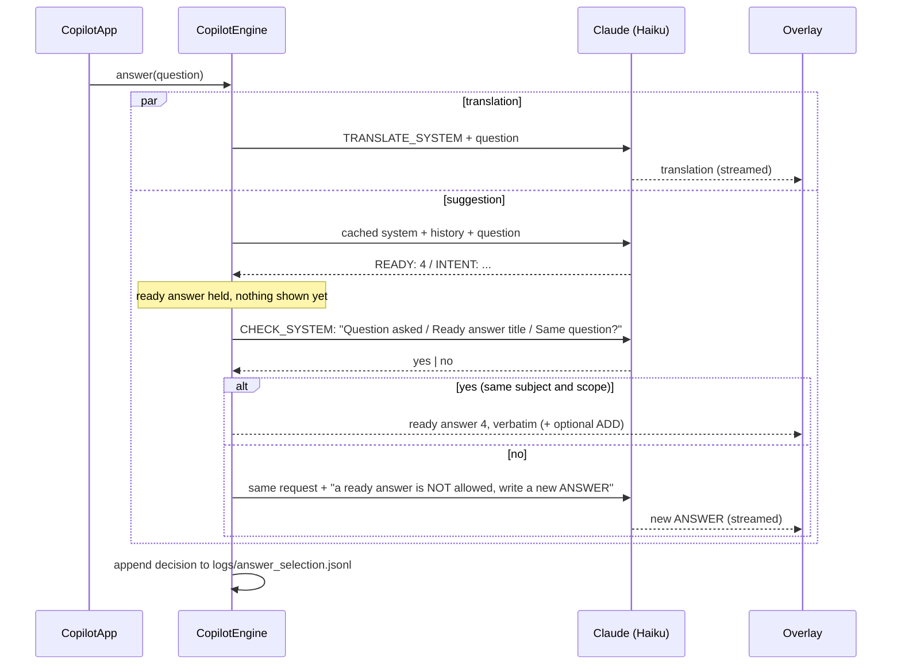

# Architecture

This document explains how Interview Copilot turns system audio into a spoken answer on screen, and why it is built this way. Module names refer to `src/interview_copilot/`.

## Components

| Component | Module | Responsibility |
|---|---|---|
| CLI | `cli.py`, `__main__.py` | `argparse` entry point: `run`, `simulate`, `check`, `devices`, `test-audio`, `mvp`, `download-docs`, `eval`; global `--profile` / `--settings` |
| Settings | `settings.py` | Loads `config/settings.toml`, deep-merges `config/settings.local.toml`, reads secrets from the environment or `.env` |
| Audio capture | `audio/capture.py` | `LoopbackCapture` over WASAPI loopback (`pyaudiowpatch`, imported lazily), `Resampler` to 16 kHz mono PCM (`TARGET_RATE`), `AudioChunk` with capture timestamp and RMS level |
| Speech-to-text | `stt/base.py`, `stt/deepgram.py`, `stt/whisper.py` | `Transcriber` interface, `Utterance` (text + speech-end time + detection time), `AudioClock`; `DeepgramTranscriber` + `DeepgramParser` (streaming WebSocket), `WhisperTranscriber` + `EnergyVAD` (local) |
| Knowledge | `knowledge/loader.py`, `ready_answers.py`, `vocabulary.py`, `docs_downloader.py` | Reads the profile into `Knowledge` (documents, ready answers, vocabulary, replacements, research domains); builds the cached context block and the ready-answer catalog |
| AI engine | `ai/engine.py`, `ai/prompts.py`, `ai/parsing.py` | `CopilotEngine`: translation, answer, ready-answer check, research, prompt caching, cancellation, stats |
| Rendering | `render.py` | `answer_parts()` turns a `Suggestion` into styled segments (`label`, `ready`, `answer`, `add`, `warn`) |
| Orchestration | `app.py` | `CopilotApp` wires capture → STT → engine → UI events; measures latency; handles actions |
| UI | `ui/overlay.py` | `Overlay`: tkinter always-on-top window, polls the event queue |
| Console | `console.py` | `build_engine`, `ask_and_print`, `research_and_print` for `simulate`, `check` and `mvp` |
| Evals | `evals/runner.py`, `judge.py`, `report.py` | Batch runs through the real engine, LLM judge, markdown report |

## Threads and queues

```
 audio thread (LoopbackCapture)
   └─ AudioChunk ──► Transcriber.feed()
                        │
 STT thread(s) (Deepgram WebSocket sender/receiver, or Whisper worker)
   ├─ on_interim(text) ───────────────┐
   └─ on_utterance(Utterance) ──► CopilotApp.ask()
                                       │
                         CopilotEngine.answer()  (non-blocking)
                           ├─ thread "ai-translate" ── on_translation ──┐
                           └─ thread "ai-suggest"   ── on_suggestion ───┤
                                                                        ▼
                                                     events: queue.Queue[tuple]
                                                                        │
 Tk main thread (Overlay) ── polls every 30 ms ◄────────────────────────┘
 hotkey thread (pynput GlobalHotKeys) ── CopilotApp.action_*()
```

- **Only the Tk main thread touches widgets.** Every other thread posts tuples such as `("question", qid, text)`, `("translation", qid, text)`, `("suggestion", qid, raw)`, `("latency", qid, total, pause, ai)` to one `queue.Queue`.
- **Each question gets an id.** The overlay ignores events for an older id, so a late translation never overwrites a newer question.
- **Cancellation by generation counter.** Every `answer()` / `research()` call increments a counter; streams compare it on each chunk and stop with `cancelled` when a newer question arrived. `cancel()` increments it explicitly (used by *clear*).
- Short utterances (fewer than `min_words_auto` words, for example "Okay.") are shown in the live line but never call the model.

## Data flow for one question

1. `LoopbackCapture` delivers 50 ms chunks (`[audio] chunk_ms`), resampled to 16 kHz mono.
2. The transcriber streams interim text and closes an `Utterance` after `pause_ms` of silence. Deepgram uses `endpointing = pause_ms` with `UtteranceEnd` as a fallback; Whisper uses `EnergyVAD` (`vad_threshold`).
3. `CopilotEngine.answer()` applies `[transcript_replacements]`, appends the turn to `history`, and starts two threads:
   - **translation**: `TRANSLATE_SYSTEM` (small, uncached), output in the profile's `native_language`;
   - **suggestion**: the cached system prompt + the last `history_turns` questions + the new question.
4. The suggestion stream is parsed on every chunk (`parse_suggestion`). New answers are shown as they stream. Ready answers are held until the "same subject?" check passes (see below).
5. `CopilotApp` records the first useful content and posts the latency: **total = pause + AI**.

## Latency budget

Target: first words on screen within 2 to 3 s of the interviewer finishing. Typical values with Deepgram and a warm cache:

| Step | Typical time | Controlled by |
|---|---|---|
| Pause detection (end of speech → utterance closed) | ~0.7 s | `[stt] pause_ms` |
| STT finalization after the pause | Deepgram ~0.1–0.3 s; Whisper GPU ~0.2–0.5 s; Whisper CPU 1–3 s or more | provider, hardware |
| First token of the answer (cache hit) | ~0.4–0.8 s | model, `effort`, thinking off, cache |
| Ready-answer "same subject?" check | short call, a few output tokens | `check_ready_answers` |
| **Measured: end of question → first words (ready answers)** | **~0.5–1 s, plus ~0.7 s of pause detection** | |

The overlay shows each measurement, for example `1.6s (pause 0.8 + AI 0.8) · avg 1.7s`, colored green up to 2 s, yellow up to 3 s and red above.

How it is measured: with Deepgram, the end of speech is the timestamp of the last word, converted to the local clock through the capture time of each chunk (`AudioClock`). With Whisper, it is the last voiced chunk.

## Prompt caching layout

```
system = [
  block 1: generic rules (build_system_prompt): role, honesty, output format,
           answer length, vocabulary list
  block 2: knowledge context block + ready-answer catalog      ◄── cache_control {ephemeral, ttl: 1h}
]
messages = [
  user: <recent_conversation> last N questions </recent_conversation>
        <interviewer_said> question </interviewer_said>          ◄── changes every call, not cached
]
```

- The context block comes from `Knowledge.context_block()` in a fixed order: `<instructions>`, `<resume>`, `<projects>`, `<skills>`, `<job>`, `<ready_answers_source>`, `<official_docs>`, each document as `<doc name="relative/path">…</doc>`. The catalog is `<ready_answer_catalog>` with `ID | Title` lines.
- Because the prefix is static, every question after the first reads it from the cache. `warm_cache()` sends a 1-token request at startup so the **first real question is already a cache hit**.
- The 1 h TTL (`[ai] cache_ttl`) covers a full interview. Use `"5m"` if your account does not accept the 1 h TTL.
- Editing any profile file changes the prefix; restart the app to reload it (the cache is rewritten once).
- `[knowledge] warn_tokens` (100,000) warns when the profile is large: bigger context means slower first answers and higher cost.
- Request options: `extra_body` carries `output_config.effort` (`low`) and `thinking: {"type": "disabled"}`; no `temperature` is sent.
- The footer shows cache tokens written / read (`stats.cache_write`, `stats.cache_read`).

## Ready-answer selection

The model never rewrites a ready answer. It only outputs `READY: <id>`; the text on screen comes from the file.



- `check_ready_answers = false` skips the check (slightly faster, less safe).
- If the check call fails, the ready answer is kept (fail open: a good prepared answer is better than nothing).
- Every decision is logged to `logs/answer_selection.jsonl` (question, chosen id, title, verdict, time). Read it after a practice session to find answers that are picked too often or too rarely.

## Output format markers

The answer call returns plain lines that `ai/parsing.py` reads into a `Suggestion`:

| Marker | Meaning | Shown as |
|---|---|---|
| `READY: <id>` / `READY: NONE` | Which ready answer to use, or none | `ready` text from the file, with its title as `label` |
| `ANSWER: …` | A new spoken answer (first person, ~`answer_words_target` words) | `answer` |
| `ADD: …` | One extra sentence after a ready answer, only for new information | `add` |
| `DOCS: …` | Conflict with the official docs, written in the native language | `warn` |
| `INTENT: …` | What the interviewer wants to know, one line in the native language | intent line |
| `NO_QUESTION` | The utterance was not a question: only the translation is shown | — |

`parse_suggestion(text, complete=False)` works on partial text while streaming; `complete=True` is used for the final render. The v1 markers `MODEL:` (for `READY:`) and the v1 intent label are accepted as aliases.

## Research hotkey

`Ctrl+Alt+D` / `F7` re-answers the last question with `[research] model` (`claude-sonnet-5-5`) and the Anthropic web search tool (`web_search_20250305`), restricted to `allowed_domains` from `profile.toml`, up to `max_uses` searches. It uses the same cached system blocks and output format, handles `pause_turn` by continuing the turn, and shows the sources (title and URL) under the answer. It is slower (several seconds) and costs more, so it only runs on demand.

## Error handling

| Situation | Behavior |
|---|---|
| `ANTHROPIC_API_KEY` missing | Engine refuses to start with a clear message; `check` reports it |
| API error during translation or answer | Shown in the status bar; the other call continues |
| `stop_reason = max_tokens` | Answer shown with a "cut off" warning (raise `max_tokens_answer`) |
| `stop_reason = refusal` | A short note is appended to the answer |
| Newer question arrives | Older streams stop (`cancelled`); nothing stale is drawn |
| Ready-answer check fails | Ready answer kept; the error is logged in `answer_selection.jsonl` |
| Web search error (for example, disabled for the organization) | `search_error()` extracts the error code; shown in the status bar |
| No Deepgram key with `provider = "auto"` | Falls back to Whisper (GPU if available; on CPU, with a latency warning) |
| Profile over `warn_tokens` | Warning in the status bar and in `check` |

## Why Deepgram by default, Whisper as an option

| | Deepgram `nova-3` (streaming) | `faster-whisper` (local) |
|---|---|---|
| Finalizes after the pause | ~0.1–0.3 s, independent of your PC | NVIDIA GPU ~0.2–0.5 s; CPU only 1–3 s or more |
| Live word-by-word transcript | yes | GPU only (every `interim_every_s`) |
| Custom vocabulary | keyterm prompting, up to 100 terms | initial prompt |
| Cost | paid per minute (free starting credit) | free |
| Needs | internet + `DEEPGRAM_API_KEY` | NVIDIA GPU with CUDA to stay within budget |

The budget leaves little room for STT: on a typical laptop without a GPU, Whisper alone can take longer than the whole target. Deepgram keeps the finalization time small and stable. `provider = "auto"` picks Deepgram when the key exists and Whisper otherwise.
